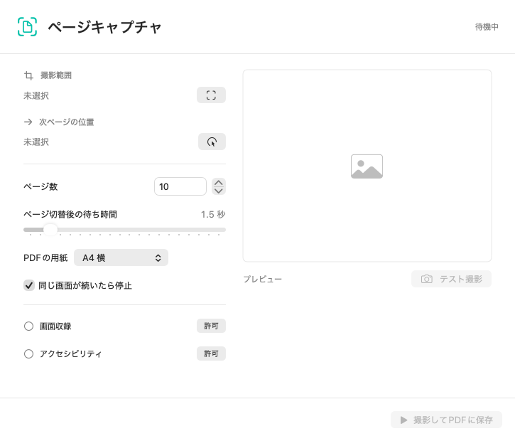
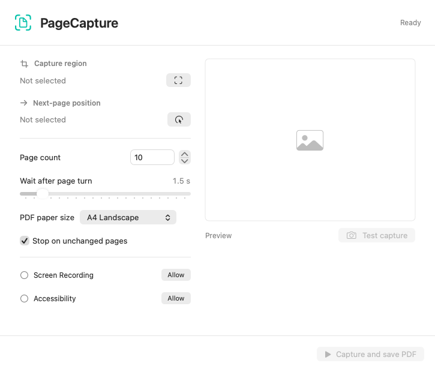

# PageCapture / ページキャプチャ

[日本語](#pagecapture--ページキャプチャ) | [English](#english)

**画面のページを順番に撮影して、印刷用PDFにまとめるMacアプリ。**

撮影範囲と「次ページ」ボタンの位置を指定すると、画面の変化を待ちながら画像を保存します。ブラウザでも、クリックでページを送れるデスクトップアプリでも使えます。



**ステータス: v0.1.0-alpha。** PDF生成・画像保存・安定フレーム判定は自動テスト済みです。実アプリでの連続撮影・クリックと、Intel Mac・macOS 14での実行は未検証です。まず動作確認用ページで少数ページを試してください。

## できること

- ドラッグで撮影範囲を選択し、クリックでページ送り位置を指定
- テスト撮影とプレビュー
- ページ数・切替後の待ち時間を指定
- 同じ画面が続いた場合の停止、メニューバーとEscからの途中停止
- A4横・A4縦・撮影画像と同じ比率のPDF出力
- 停止やエラー時も撮影済みページをPDFに保存
- 元のPNGを連番で保存
- 日本語・英語の画面表示

## 対応環境

- macOS 14以降
- Apple Silicon / Intel Mac向けにビルド可能
- 画面収録の許可。自動クリックにはアクセシビリティの許可も必要

アプリはSwift、SwiftUI、AppKit、ScreenCaptureKit、Core Graphicsで実装しています。外部ライブラリは不要です。

## インストール

配布ZIPがある場合は展開し、`PageCapture.app`をApplicationsフォルダなどに置いてから開いてください。配置を決めてから許可を設定します。

alpha版はローカルのアドホック署名です。Apple Developer ID署名・公証は行っていません。macOSから実行が拒否される場合は、配布元と内容を確認したうえで、下記のソースからのビルドも選べます。

1. アプリ内の「許可」からシステム設定を開きます。
2. 「画面収録」と「アクセシビリティ」でPageCaptureを許可します。設定の名称はmacOSのバージョンにより異なります。
3. macOSが再起動を求めた場合は、アプリを終了して開き直します。

## 使い方

1. 対象のブラウザやアプリで、最初のページを表示します。
2. 撮影範囲のアイコンから、ページ部分をドラッグで囲みます。
3. 次ページの位置のアイコンから、ページ送りボタンをクリックします。位置選択中はページを送りません。
4. テスト撮影で範囲を確認し、ページ数・待ち時間・用紙を設定します。
5. 「撮影してPDFに保存」で保存先を選びます。3秒後に開始します。
6. 完了後、PDFを開いて内容を確認してから印刷します。

撮影中は対象ウィンドウの位置・サイズ・ズーム・タブを変更せず、マウスやキーボードの操作を控えてください。別アプリが前面になった場合は停止します。同じアプリ内のタブやウィンドウの変更までは判別できません。

停止は画面上部のメニューバーから行えます。アクセシビリティ許可が有効ならEscも使えます。PDFと同じ場所に`ファイル名-pages-識別子`フォルダを作り、撮影画像を残します。

詳しい説明は[使い方](使い方.md)、実画面の確認項目は[手動テスト](docs/manual-testing.md)を参照してください。[動作確認用ページ](docs/demo.html)は手元のブラウザで開けます。

## 表示言語

日本語と英語に対応しています。macOSの言語設定、またはアプリごとの言語設定に従って表示します。未対応の言語では英語にフォールバックします。言語を変更した場合はアプリを開き直してください。

ボタン、ツールチップ、進捗、エラー、保存ファイル名、権限説明は`Resources/ja.lproj`と`Resources/en.lproj`に外出ししています。英語のページ数の単数・複数表現は`Localizable.stringsdict`で定義しています。[翻訳の追加・修正](docs/localization.md)を参照してください。

## 制限

- PDFは画像です。OCR、文字検索、テキスト選択はありません。
- 解像度は画面表示に依存します。印刷前に文字の読みやすさを確認してください。
- ページ送りはクリックのみです。キー入力・スクロール・スワイプには対応していません。
- 同じ内容のページや、小さな差だけのページは重複と判定する場合があります。「同じ画面が続いたら停止」をオフにすると変化検出を省略できます。
- 約15秒で画面が安定しない場合は停止します。読み込み完了を完全に判別する機能はありません。
- ウィンドウの移動や重なりによって、別の内容が写る場合があります。
- 自動アップデート、設定の保存、Developer ID署名・公証は未実装です。

## プライバシー

アプリから画像やPDFを外部送信しません。ログイン情報、ブラウザの通信内容、アカウント情報を取得・保存する機能はありません。選択した画面部分だけを撮影し、指定した保存先にPNGとPDFを保存します。

## ビルドとテスト

Xcode Command Line ToolsとmacOS 14以降のSDKが必要です。

```bash
# 使用中のMacのアーキテクチャでビルド
bash build.sh

# Apple Silicon / Intel両対応のUniversalビルド
ARCHS="arm64 x86_64" bash build.sh

# 生成物
open dist/PageCapture.app

# 合成画像を使った自動テスト。画面収録やクリックの許可は不要
bash scripts/test.sh

# オフスクリーンでのUI描画も確認
RENDER_UI=1 bash scripts/test.sh

# 配布ZIPを作成
bash scripts/package.sh
```

自動テストは画像の読み書き、安定フレームと重複の判定、PDFの用紙寸法・ページ順・上書き、部分保存、エラー時の既存PDF保持を確認します。画面キャプチャと自動クリックの実動作は手動テストの対象です。GitHub Actionsでもビルドと自動テストを実行する設定を含めています。

## コントリビューション

不具合報告ではmacOSのバージョン、CPU、再現手順、期待した動作と実際の動作を記載してください。ログインURL、個人情報、教材や書籍のページ画像を含めないでください。合成資料で再現できると助かります。

変更を送る際は`bash scripts/test.sh`を実行し、撮影やクリックに関わる変更は手動テストも確認してください。詳細は[CONTRIBUTING.md](CONTRIBUTING.md)に記載しています。

## ライセンス

[MIT License](LICENSE). Copyright (c) 2026 fuminaka1014.

---

## English

**Capture pages on your screen and combine them into a print-ready PDF on macOS.**

Select a capture region and the position of a next-page button. PageCapture clicks the button, waits for the image to settle, and saves each page. It works with browsers and desktop apps that use a clickable next-page button.



**Status: v0.1.0-alpha.** Synthetic-image tests cover image saving, frame stability, duplicate detection, and PDF export. Real screen capture and clicking, execution on Intel Macs, and execution on macOS 14 are not yet verified. Start with a few synthetic pages before using it for longer captures.

### Features

- Select a region by dragging and a next-page button by clicking.
- Preview a test capture and configure the page count and wait time.
- Stop on unchanged pages, or stop from the menu bar or with Esc.
- Export image PDFs in A4 landscape, A4 portrait, or the original image aspect ratio.
- Keep captured pages when a session is stopped or an error occurs.
- Keep numbered PNG files alongside the PDF.
- Japanese and English interfaces, including tooltips, status messages, and errors.

### Requirements and Installation

macOS 14 or later. Builds support Apple Silicon and Intel Macs. Screen Recording permission is required; automatic clicking also requires Accessibility permission.

Extract the distribution ZIP and place `PageCapture.app` in Applications or another permanent location before granting permissions. This alpha build is ad-hoc signed, without Apple Developer ID signing or notarization. You can also build it from source.

Open the app and use **Allow** to open System Settings. Grant **Screen Recording** and **Accessibility** access, then restart the app if macOS requests it.

### Usage

1. Show the first page in the target browser or app.
2. Select the page area using the capture-region button.
3. Select the next-page button. Selecting its position does not turn the page.
4. Use **Test capture** to check the crop, then set the page count, wait time, and PDF paper size.
5. Choose **Capture and save PDF**, then choose a destination. Capture begins after a three-second countdown.
6. Open the finished PDF, check its contents, and print it.

Keep the target window, zoom, and tab unchanged during capture. Avoid mouse and keyboard input. The app stops if another app comes to the front, but it cannot distinguish tab or window changes within the same app.

Use the menu-bar item or Esc to stop. Captured PNGs remain in a `filename-pages-identifier` folder next to the PDF. See the [English guide](docs/usage-en.md) for more details. The [synthetic test pages](docs/demo.html) can be opened directly in your browser.

### Language

The interface follows macOS's preferred language or the app-specific language setting. Japanese and English are available; other languages fall back to English. Restart PageCapture after changing its language.

Strings are stored in `Resources/ja.lproj` and `Resources/en.lproj`. App metadata and permission descriptions use `InfoPlist.strings`, and English page-count plurals use `Localizable.stringsdict`. See the [localization guide](docs/localization.md).

### Limitations and Privacy

PDFs contain images, without OCR, searchable text, or text selection. Resolution depends on the displayed page. Page turning supports clicks only, without keyboard, scroll, or swipe automation. Unchanged or subtly different pages may be considered duplicates; disable **Stop on unchanged pages** when appropriate. Capture stops if the image does not settle within about 15 seconds, and it cannot guarantee that a page has finished loading.

Overlapping windows may appear in captures. Automatic updates, saved settings, Developer ID signing, and notarization are not implemented. Screen capture and clicking require the [manual checks](docs/manual-testing.md), separate from the automated tests.

PageCapture does not upload images or PDFs. It does not collect login credentials, account information, or browser traffic. Captured PNGs and PDFs are saved to the destination you select.

### Build and Test

Install Xcode Command Line Tools with a macOS 14 or newer SDK. The app uses Swift and Apple frameworks, without third-party libraries.

```bash
# Build for the current Mac
bash build.sh

# Build a Universal app for Apple Silicon and Intel
ARCHS="arm64 x86_64" bash build.sh

# Run tests, including localization resources and plural forms
bash scripts/test.sh

# Render initial, completed, running, and error states in both languages
RENDER_UI=1 bash scripts/test.sh

# Package the app with Japanese and English usage guides
bash scripts/package.sh
```

The app is generated at `dist/PageCapture.app`; distribution archives are generated in `dist/`. Automated tests do not capture the screen or click other apps. GitHub Actions is configured to build and test the app.

### License

[MIT License](LICENSE). Copyright (c) 2026 fuminaka1014.
